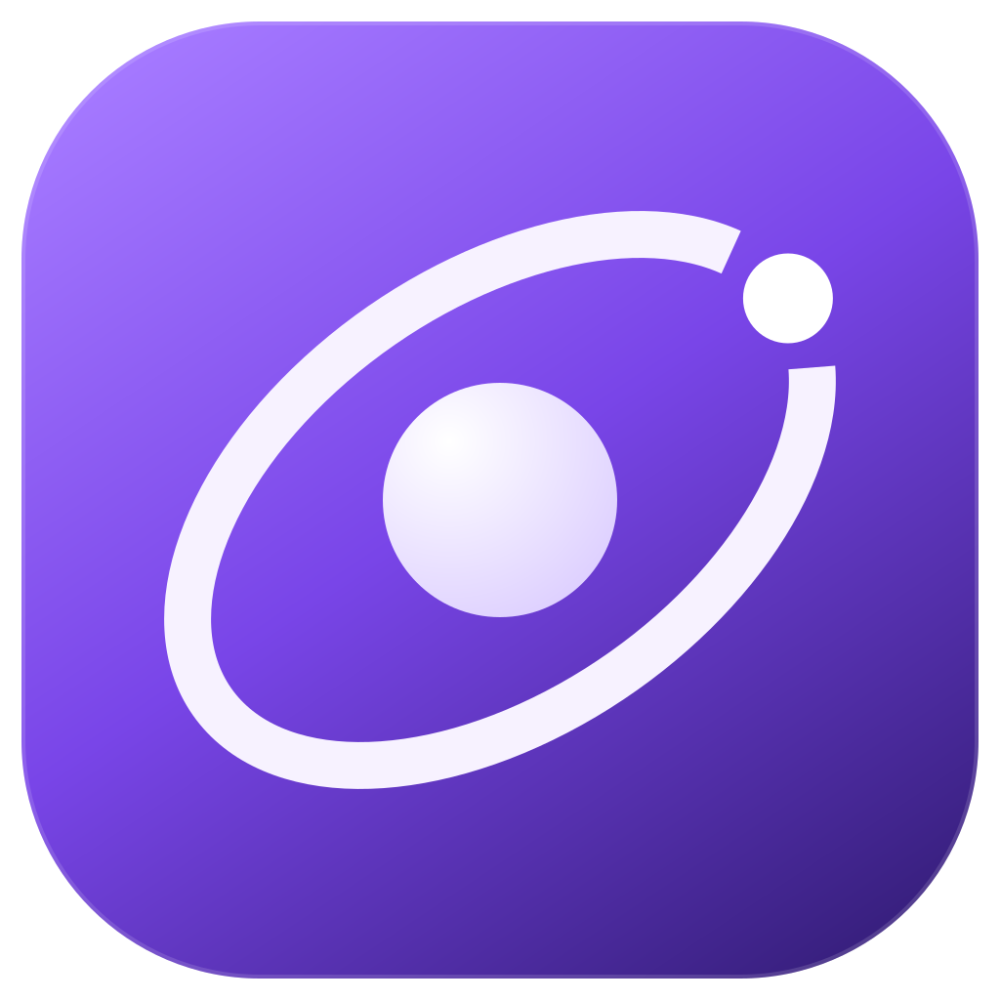

# Helium Neo

<div align="center">
    
    <p>A private Helium fork with split workspaces, mobile previews, documented screenshots, and experimental WebKit playback.</p>
</div>

Helium Neo builds on [Helium](https://helium.computer/) and keeps this fork's
changes and pull requests in [aagedal/helium](https://github.com/aagedal/helium).
It retains Helium's privacy-focused foundation and adds the features below.

## What this fork changes

### Split workspaces

- **Two to six panes in one tab**, with columns, rows, grids, and mixed layouts.
  Right-click a tab and use **Split Layout** to choose a preset. Existing pages
  are retained, and additional panes open new-tab pages.
- **Resizable boundaries throughout the split**, including the inner dividers
  of grids and mixed layouts. Drag a divider or focus it and use arrow keys.
- **See the active pane** with the normal sub-tab background highlight,
  including compact pinned tabs and vertical tabs. Expanded vertical pinned
  splits use icon tiles, wrapping larger splits to fit the sidebar. Click a sub-tab in the current split to select its pane.
- **Reload the focused pane** with Command-R, including bypass-cache reload.
  Explicitly selecting additional tab-strip tabs retains multiple-tab reload.
- **Pinned splits return across sessions** with their pages, layout, divider
  sizes, and each pane's mobile mode and auto-refresh interval. This works with
  new-tab startup as well as last-session restore.
- **Zen mode preserves the sidebar state**, including its remembered width
  and whether it is collapsed. Entering Zen mode does not force it open.

### Per-tab rendering and refresh

Right-click a tab and open **Tab view**. Each setting belongs to that individual
page, including when it is part of a split.

- **Mobile preview (402 × 874)** provides a fixed portrait CSS viewport with
  3× device density and touch emulation, scaled to fit the pane.
- **Mobile preview (402 wide, full height)** keeps the mobile width and uses
  the entire pane height, with no fixed portrait-height cap. Narrow panes scale
  the preview down to fit.
- **Auto-refresh** offers 5, 10, 15, 30 and 45 seconds; 1 minute; 1 minute
  30 seconds; 2, 3, 5, 10 and 30 minutes; and 1 hour. Optional **Vary each
  refresh by ±5%** chooses a fresh delay each time. This spreads requests;
  it does not guarantee avoiding bot detection. Automatic reloads are limited
  to two at once across the browser, with failure backoff. Loading, sleeping,
  crashed and POST pages, and pending navigations are skipped.
- **Create desktop/mobile workspace** makes desktop and mobile copies in a
  pinned saved tab group, with a side-by-side split. The original page is kept.

Mobile previews run without opening a DevTools window. They use Chromium's
mobile viewport and touch emulation, plus an Android mobile Chromium identity
in the user agent and Client Hints. Switching between desktop and mobile reloads
eligible pages so device detection runs again. The rendering engine remains
Chromium. Per-tab settings are restored locally and are not synced between devices.

### Page change monitoring

Under **Tab view**, enable **Monitor article text for changes**, or select text
inside a paragraph or section and choose **Monitor selected section for changes**.
The browser saves a text baseline and checks it once after each completed load.
Enable auto-refresh for regular checks. A tab attention indicator signals a change;
**Review page changes…** shows the latest removed and added text, the last successful
check time, and export status. Reviewing acknowledges the indicator.

Only the latest two versions are retained in memory. Checks exclude navigation,
hidden elements and editable fields, and stop at bounded text, node and time limits.
Missing sections, empty text and failed scans retain the previous baseline instead
of reporting a deletion. Positional section selectors may need reselecting after
a site redesign. Checks do not continuously observe live page mutations or inspect
cross-origin frames. Navigating to another URL stops monitoring. The experimental
WebKit renderer is not supported.

Optionally enable **Automatically save a screenshot on change** and/or
**Automatically save a PDF on change**, then choose a change export folder.
Screenshots preserve the visible pane as an SDR PNG, capped at eight megapixels;
hidden panes cannot supply fresh screenshots. PDFs preserve the page's print
layout, which may differ from its interactive display. Each export has a JSON
source record with the previous/current text, observed change time, URL and SHA-256
checksum. PNGs also embed source metadata. Exports follow detection and may reflect
later page updates; they do not establish authenticity or original publication time.

Only one monitored tab exports at a time; competing exports are skipped and reported
in **Review page changes…**. Encoding and file writes run off the browser UI thread.
Automatic refresh waits while the tab is scanning or exporting. An export timeout
turns automatic exports off while allowing text monitoring to continue. Interval,
jitter and watched section restore locally; text history and export opt-ins do not
persist after restarting the browser. Automatic exports require enabling again.

### Find an image on the page

After a reverse image search, find where a picture appears on an image-heavy
page. Press Command-F and paste a copied image into the empty find field, drag
an image file or a picture from another page or app onto the find bar, or click
the image button in the find bar to paste, choose an image file, or reuse an
image chosen from a page. The find bar counts the matches; Enter, Shift-Enter
and the arrow buttons scroll to each outlined match. Typing text returns to an
ordinary text search, and closing the find bar removes the outlines.

Right-click an image and choose **Find this image in other tabs** to search the
other tabs in the window and switch to the best match. Afterwards, **Find chosen
image on this page** in a page's context menu looks for it again there.

Matching compares appearance rather than files, so it tolerates resizing,
recompression, different formats, and crops in either direction, including
partly overlapping crops of at least about half the image. Mirrored or rotated
copies, CSS background images, iframes and shadow DOM are not covered. Up to
300 lazy images, nearest the current position first, are loaded before
comparing, including script-driven ones that keep their address in attributes
such as `data-src` or `data-srcset`. The page is never scrolled, so infinite
scroll does not fetch more content.
Renderers send small grayscale thumbnails to the browser for comparison; images
are not uploaded anywhere. Pasted and chosen files are decoded in a sandboxed
process. The chosen image is remembered per profile until the browser restarts.

### Experimental WebKit playback on macOS

On macOS 14 or later, enable
**`helium://flags/#helium-webkit-streaming-tabs`** and restart to host WebKit
pages inside Helium tabs. HTTPS pages on Netflix, TV 2 Play (`play.tv2.no`),
HBO Max, Max, and Disney+ use WebKit automatically. Each tab has its own page;
WebKit tabs in the same Helium profile share a separate persistent WebKit login
and cookie store. Private and guest profiles remain on Chromium.

With the flag enabled, right-click an ordinary HTTP(S) tab and select
**Use WebKit renderer (reloads page)** to switch manually. Select it again to
return the current WebKit URL to Chromium. A manual WebKit tab keeps subsequent
HTTP(S) address-bar navigation in WebKit; an automatically routed tab returns to
Chromium for an ordinary URL. Opening an internal or local page returns to
Chromium. Switching renderers reloads the URL without transferring page state,
form submissions, cookies, or logins. Renderer choices are not restored across
sessions.

Helium's address bar and tab title display the WebKit page, and its normal
Back, Forward, Reload, and bypass-cache reload commands control that page.
Chromium has no certificate information for WebKit pages, so the location bar
does not present Chromium security or certificate state for them.

This prototype is disabled by default. Extensions, Chromium history and
site-data controls, downloads, printing, DevTools, and other browser integrations
are not fully connected to WebKit. WebKit sessions are not restored; switching
away suspends media, and returning requires an explicit playback resume.
Protected playback was confirmed for Netflix and TV 2 Play in the separate
native-window mode; protected playback in the tab host and on the newly added
services still needs verification. Split-pane behavior, fullscreen, and
accessibility also need broader testing.

For separate native streaming windows, enable
**`helium://flags/#helium-webkit-streaming`** instead. The tab-hosting flag takes
precedence when both are enabled. See the
[WebKit experiment notes](experiments/macos-webkit-drm/README.md) for validation
history and remaining integration work.

### Startup and identity

- Background session and pinned tabs load when needed, reducing startup work.
- The app uses the **Helium Neo** name and violet orbital icon, including a
  macOS icon asset that preserves the orbital artwork in the Dock.
- Separate macOS bundle, profile, and Keychain identities allow Helium Neo to
  coexist with the normal Helium release. Existing Helium profiles are not
  migrated. The local development launcher uses its own development profile.

### Screenshots with source documentation

Press **Command-Shift-S** on macOS (**Ctrl-Shift-S** on Windows/Linux), or
right-click an HTTP or HTTPS page and choose **Capture screenshot with source…**,
then drag a rectangle over the content to preserve. In a split workspace, the
shortcut uses the focused pane; the context menu uses the pane you right-clicked.
Release the mouse to capture only your rectangle. Escape cancels selection.
Press Enter instead of dragging to capture the visible pane using the keyboard.
The macOS File menu also shows the command and its shortcut. Change the binding
in **Settings → Keyboard shortcuts**, under **Capture screenshot with source**.

The review dialog records the page URL, title, capture times in UTC, selection
bounds and image dimensions. You can optionally enter a post permalink, posting
account, publication date as displayed, post text, notes, and accessibility alt
text. Post text is entered manually and kept separate from notes and alt text.
These entries are recorded separately from observed page details. The browser can
suggest a post permalink for Twitter/X, Instagram, Facebook, Threads, Truth Social, Bluesky,
TikTok, Reddit, YouTube, LinkedIn, Mastodon and Telegram using visible links and
the post container overlapping your selection. One clear match fills the field;
multiple matches offer a chooser. Check or edit the link before saving. The
record preserves candidate links and the chosen link's origin. Suggestions are
heuristics, not verified attribution. Posting account and publication date can
also fill from the selected post when the site exposes them. The record keeps
the displayed date, any tooltip or machine-readable timestamp, and linked
account details separate from your reviewed values. Relative dates and missing
timezones are preserved as shown. You can edit or clear any field; notes remain
manual. The screenshot capture time is always recorded separately.
For supported social timestamp links that expose the full date only on hover, the
browser briefly hovers the timestamp after capturing the pixels. It uses that
full date for the publication field and keeps the relative label separately.
If the tooltip is unavailable, the original site text remains the fallback.
For Twitter/X and Threads quote posts, a capture including the enclosing post prefers its
permalink, account and date. A crop confined to the quoted post prefers the
original. Both links remain available in the source chooser, and the embedded
record preserves their relationship and separate source details. Facebook photo
posts prefer the enclosing post's permalink, account and date; attached photo
links remain available as secondary sources, including for a photo-only crop.

Bluesky feed posts, reposts and thread replies use their own observed permalink,
matching profile link and timestamp. Expanded posts use their scoped date footer;
the displayed time is preserved without assuming a timezone. A crop confined to
a quoted post with no exposed permalink stays ambiguous instead of filling the
enclosing post's source. Linked quotes keep their separate source details.

TikTok recognizes explicit video and photo permalinks. Its current article layout
can use the page URL only when the article's own item ID matches that URL. The
matching creator profile and adjacent date label provide attribution, including
when adjacent posts are preloaded. A capture including an unsupported comment or
a caption link to another post requires source review. Relative
dates and dates without a year stay as displayed. Captions and comment dates do
not supply publication dates. Shortened share links are not resolved.

Reddit's current layout keeps posts, comments and nested replies separate. Each
item needs an observed permalink and matching item IDs. Author profile links
must agree with that item's author, and its credit-row timestamp must match its
reported creation time. Capturing multiple items, crossposts or a reference link requires
source review. Deleted authors and missing dates stay blank. Shortened share
links are not resolved; Old Reddit layouts are not yet supported.

YouTube recognizes video, Shorts, live and `youtu.be` links. Watch-page video
crops require the page URL and the rendered video's ID to agree; Shorts use their
own player link and channel bar. Comment crops keep their own `lc` permalink,
author and displayed date. Relative labels and “edited” markers stay as shown;
Shorts dates remain blank when no scoped date is exposed. Captures including
multiple sources, reference links, recommendations or known active ads require
review. Channel names and profile URLs stay as observed, without resolving
channel IDs into guessed handles. Playlists and playback times remain in the
original observed URL, separate from the normalized video permalink.

LinkedIn support currently targets public activity cards. An explicit post URL
must match the card's own activity ID; the author's linked display name and the
header's date label provide attribution. Relative labels and “Edited” markers
stay as shown. Comments without exposed permalinks need manual attribution, and
captures including both a post and comments require review. Share IDs, profile
slugs and numeric activity IDs are not used to guess authors, URLs or dates.
Authenticated layouts, articles and shortened `lnkd.in` links are not supported
by this addition. Live capture verification remains limited by sign-in overlays.

Mastodon support targets the standard web app's timeline and detailed status
layouts across instances. It requires a post's own matching author profile and
timestamp link. Remote accounts retain their observed handle and instance-local
permalink; status IDs are never translated into home-instance URLs. Boost actors,
mentions and edited labels do not replace the original author or publication time.
Other clients, ActivityPub URI-only layouts and missing ownership evidence require
manual attribution. These DOM observations remain unverified.

Telegram supports public channel message previews and standalone message widgets
on `t.me`. The message's own timestamp permalink must match its `data-post`
identity; account suggestions require its matching channel header link. Video
durations and edited labels do not supply publication dates. Forwarded messages
retain the publishing channel and its message time, without claiming original
authorship. Reply previews and selected references require review. Private channels,
chat clients, invitation links and channel landing pages without visible messages
are not supported.

The review dialog places editable **Source details** beside a live, read-only
**IPTC / XMP preview**, stacking the preview below the form in narrow windows.
Expand **Image description and notes**, **Export options**, and **Capture
details** as needed. **Show XMP field names** reveals technical property names;
focusing a source field highlights its related metadata headings. The preview
updates as you edit and shows the values that will be embedded in the saved
image, including the complete structured source record. Save and Copy remain
visible outside the scrolling review area.

Choose **PNG**, **JPEG** (quality 95), or **JPEG XL** in the review dialog. PNG
and JPEG XL use lossless compression; JPEG uses lossy compression. Each image
embeds IPTC Core fields in XMP, including a readable source description, capture
date and posting account, plus the complete source record. Capture limitations
remain in the structured source record and ZIP text report. The page title fills
both Title and Headline; the post permalink remains in Description. The browser
and version are stored in Creator Tool, and the description omits copyright and language
settings. The posting account is recorded as a source, not assumed to be the
image creator or copyright owner.

The embedded fields are arranged for photo and newsroom metadata tools:

- **Title and Headline:** the captured page title.
- **Description:** the readable source report, including the reviewed post
  permalink, account, publication date, manually entered post text, and notes
  when supplied.
- **Alt Text (Accessibility):** your optional image description. Empty alt text
  is omitted; post text and notes are never used as a substitute.
- **Source:** the reviewed posting account and post permalink, separated by
  ` / ` when both are supplied; the page URL is also preserved
  separately in XMP Source.
- **Date Created:** the screenshot capture time, separate from the post's
  publication date. **Creator Tool** identifies the browser and version.

The complete structured source record remains embedded in every format,
including observed values, reviewed values and how each was obtained. The ZIP's
`source.txt` retains the capture limitations alongside the readable report.

The IPTC Copyright Notice uses **Screenshot / [account] / [platform]**.
Choose **Norsk — Skjermbilde** under **Copyright text language** for
**Skjermbilde / [account] / [platform]**. The choice is remembered, and a live
preview shows the resulting text. Twitter/X uses the platform name **Twitter**.
When no posting account is supplied, the notice falls back to
**Screenshot / [hostname]** or **Skjermbilde / [hostname]** for any website
(for example, **Screenshot / tv2.no**). The hostname omits `www.`, the page
path, query and fragment.

**Automatically preserve HDR** is on by default and remembered for your profile.
When the selected rendered pixels contain HDR brightness, the dialog automatically
chooses **16-bit JPEG XL**, including Rec.2100 PQ color information. Ordinary
SDR selections save at 8-bit. You can turn preservation off or choose PNG/JPEG
for SDR output; the dialog and embedded record identify the conversion. HDR
readback availability, detection, output depth and color encoding are recorded.
The preview and clipboard are SDR. HDR already tone-mapped by the webpage,
renderer or display pipeline cannot be recovered by screenshot capture.

**Save capture** saves the image alone by default, with embedded IPTC metadata.
Saved filenames include the capture time in UTC, source hostname and page title,
so captures are easier to identify in a folder. Names use the page details recorded
at capture time. Titles retain non-English characters; unsafe filename characters
are replaced and long names are shortened. Direct saves add a unique suffix to
protect earlier exports, including repeated saves of the same capture.
**Save directly to screenshot folder** is enabled by default: choose a folder
once, then subsequent captures save there without a location prompt. Use
**Choose screenshot folder…** to change it, or turn off direct saving to choose
a destination for each capture. The folder and direct-saving choice are remembered
for your profile. **Captured by (username)** remembers the person taking the
screenshot and embeds it as IPTC Creator, separately from the posting account.
Enable **Include source report and checksum (ZIP)** for a ZIP containing
`screenshot.png`, `.jpg` or `.jxl`, `metadata.json` and a readable `source.txt`,
with a SHA-256 hash of the completed image. Format and ZIP choices are remembered
for your profile. **Copy image** copies pixels without the embedded source record.
A capture preserves the selected rendered region. Capture times use the computer's
clock; the hash alone does not establish authenticity or publication time.

Split layouts remain experimental. Geometry and viewport helpers have standalone
sanitizer checks; the full Chromium browser regressions require an unpruned test
build. See [developer notes and validation](devutils/README.md).

## Builds and downloads

This repository contains the fork's patches, resources, and build utilities.
The latest release documented here is
[Helium Neo 0.19.4.1](https://github.com/aagedal/helium/releases/tag/v0.19.4.1-neo),
based on Chromium **155.0.8059.84**, for Apple Silicon Macs running macOS 13 or
later. Download the
[signed and notarized DMG](https://github.com/aagedal/helium/releases/download/v0.19.4.1-neo/Helium-Neo-0.19.4.1-macOS-arm64-signed.dmg)
and drag **Helium Neo** to Applications. The release includes `SHA256SUMS` for
the final installer. Previous releases are available on the
[Helium Neo releases page](https://github.com/aagedal/helium/releases). Standalone
packages include their runtime libraries. With browser updates enabled in Helium
services settings, Neo checks on startup and daily and downloads signed updates
from GitHub, falling back to independently hosted feeds and installers on
aagedal.me. Install this release manually once if upgrading from a beta. See
[release and update tooling](devutils/macos/README.md) for signing, validation,
and mirror deployment.

The [official Helium downloads](https://helium.computer/) distribute upstream
Helium and do not include Helium Neo's custom features.

For the prepared local Apple Silicon development build:

```sh
~/Developer/helium/build/build-local.sh
~/Developer/helium/build/run-local.sh
```

The launcher opens `Helium Neo.app` using a separate development profile. This
component build depends on libraries beside the app in its build output folder;
keep that folder intact. Chromium and Sparkle automatic updates are disabled in
the local development build.

Read [AGENTS.md](AGENTS.md) before modifying the shared build cache and
[devutils/README.md](devutils/README.md) for feature details, resource generation,
and validation commands.

## Upstream Helium repositories

These links describe the upstream project and its packaging, services, and tools.

### Platform packaging and tooling
- [Helium for macOS](https://github.com/imputnet/helium-macos)
- [Helium for Linux](https://github.com/imputnet/helium-linux)
- [Helium for Windows](https://github.com/imputnet/helium-windows)

### Web services
[Helium services](https://github.com/imputnet/helium-services) are Helium's
privacy-first cloud services that handle the extension proxy, !bangs, filter
lists, browser updates, crash reports, and etc. The services are self-hostable
and the repo includes exactly what we use and host, down to Ansible playbooks.

### Components
- [Helium uBlock Origin](https://github.com/imputnet/uBlock) is a
Helium-specific fork of uBlock Origin that includes our filters, defaults, and
CNAME uncloaking.

- [Helium onboarding](https://github.com/imputnet/helium-onboarding) includes
the browser setup experience seen at `helium://setup` on first launch.

- [Helium non-free assets](https://github.com/imputnet/helium-nonfree-assets)
repo handles non-free assets used in Helium, such as search engine icons and
icons of other browsers.

### Tooling
- [Chromium tarballs](https://github.com/imputnet/chromium-tarballs) creates
prepared Chromium source archives used by Helium builds.

- [Helium Prism](https://github.com/imputnet/helium-prism) is a Svelte UI
Component library used in onboarding and the landing page.

### Legal documents
[Helium Legal](https://github.com/imputnet/helium-legal) repo includes the
source for [Terms of Use](https://helium.computer/terms) and
[Privacy Policy](https://helium.computer/privacy) documents, along with their
full change history.

## Development and contributions

The [upstream macOS development guide](https://github.com/imputnet/helium-macos/blob/main/docs/building.md#development-build-and-environment)
describes the packaging toolchain. Use this private fork as the source of custom
patches and preserve the prepared local cache described above.

Changes and pull requests for Helium Neo must target
[aagedal/helium](https://github.com/aagedal/helium). Do not send AI-assisted
contributions from this fork to the official Helium repositories. Upstream's
[contribution guidelines](CONTRIBUTING.md) describe its separate policies.

## Credits

### The Chromium project
[The Chromium Project](https://www.chromium.org/) is at the core of Helium,
making it possible in the first place.

### ungoogled-chromium
Helium originally branched off
[ungoogled-chromium](https://github.com/ungoogled-software/ungoogled-chromium).
Special thanks to everyone behind ungoogled-chromium, they made working with
Chromium much easier.

### Other Chromium projects

Helium includes some patches from other open source Chromium projects:

- [Inox patchset](https://github.com/gcarq/inox-patchset)
- [Debian](https://tracker.debian.org/pkg/chromium-browser)
- [Bromite](https://github.com/bromite/bromite)
- [Iridium Browser](https://iridiumbrowser.de/)
- [Brave](https://github.com/brave/brave-core)

All patches are sorted by vendor in the [patches](patches/) directory of this repo.

## License
All code, patches, modified portions of imported code or patches, and
any other content that is unique to Helium and not imported from other
repositories is licensed under GPL-3.0. See [LICENSE](LICENSE).

Any content imported from other projects retains its original license (for
example, any original unmodified code imported from ungoogled-chromium remains
licensed under their [BSD 3-Clause license](LICENSE.ungoogled_chromium)).
